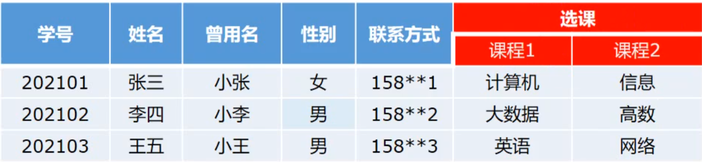

# 数据库原理

## 1.1 概述

### 1.1.1 四个基本概念

#### 数据

::: info 定义
**数据**是描述事物的符号记录。数据的特点是与其语义不可分。
:::

数据示例：`（张三，男，199505，福建省莆田市，2013，计算机与信息工程学院）`。

#### 数据库

::: info 定义
**数据库（Database，DB）**是长期存储在计算机内、有组织、可共享的大量数据的集合。
:::

| 特点 | 说明 |
| --- | --- |
| **有组织** | 按一定的数据模型（数据结构）存储和描述数据 |
| **可共享** | 可以为各种用户共享 |
| **冗余度较小** | 减少不必要的数据重复 |
| **数据独立性高** | 数据的组织或存储变化对应用的影响较小 |
| **易扩展** | 能够随应用需求扩展 |

#### 数据库管理系统

**数据库管理系统（DBMS，Database Management System）**是位于用户与操作系统之间的一层软件，用于科学地组织和存储数据，并高效地获取和维护数据。

| 主要功能 | 内容 |
| --- | --- |
| **数据定义** | 使用数据库定义语言（DDL）描述数据库对象 |
| **数据组织、存储和管理** | 管理数据库中的数据及其存储 |
| **数据操纵** | 使用数据操纵语言（DML）查询、插入、删除和修改数据 |
| **事务管理和运行管理** | 保证数据库运行的安全性和完整性 |
| **建立和维护** | 建立数据库并进行维护 |
| **其他** | 与其他软件系统通信、数据转换、异构数据库互访 |

#### 数据库系统

::: tip 组成关系
**数据库系统（DBS）＝数据库（DB）＋数据库管理系统（DBMS）＋应用程序＋数据库管理员。**
:::

### 1.1.2 数据管理技术的产生和发展

数据管理技术发展的动力包括：

- 应用需求的推动。
- 计算机硬件的发展。
- 计算机软件的发展。

| 阶段 | 名称 |
| --- | --- |
| 1 | **人工管理阶段** |
| 2 | **文件管理系统阶段** |
| 3 | **数据库系统阶段** |

### 1.1.3 数据库系统的特点

| 特点 | 说明 |
| --- | --- |
| **数据结构化** | 是数据库的主要特征 |
| **共享性高、冗余度低、易于扩充** | 面向整个系统共享，而不再只面向某个应用 |
| **数据独立性高** | 包括物理独立性和逻辑独立性 |
| **统一管理和控制** | 由数据库管理系统统一执行完整性检查、安全性保护、并发控制和数据库恢复 |

**数据独立性**分为：

| 类型 | 含义 |
| --- | --- |
| **物理独立性** | 应用程序与数据库中数据的物理存储相互独立 |
| **逻辑独立性** | 应用程序与数据库的逻辑结构相互独立 |

数据库管理系统的控制内容包括：

- **完整性检查**：保证数据的正确性、有效性和相容性。
- **安全性保护**。
- **并发控制**：避免多个用户同时访问时发生冲突。
- **数据库恢复**：能够恢复到某一已知状态。

## 1.2 数据模型

**数据模型**用于抽象、表示和处理现实世界的数据与信息，是现实世界的模拟。数据模型应满足以下要求：

- 能够比较真实地模拟现实世界。
- 容易为人所理解。
- 便于在计算机上实现。

### 1.2.1 两类数据模型

| 类型 | 视角与用途 |
| --- | --- |
| **概念模型** | 按用户的观点对数据和信息建模，主要用于数据库设计 |
| **数据模型** | 按计算机系统的观点建模，描述数据在系统内部的表示方法和存取方法；包括网状模型、层次模型、关系模型等 |

::: info 客观对象的两步抽象
1. 将现实世界中的客观对象抽象为概念模型。
2. 将概念模型转换为某一数据库管理系统（DBMS）支持的数据模型。
:::

### 1.2.2 概念模型

**概念模型**用于信息世界建模，是现实世界到机器世界的中间层次，也是数据库设计工具和设计人员与用户交流的语言。

概念模型的基本要求：

- 具有较强的语义表达能力，能够方便、直接地表达应用中的语义知识。
- 简单、易于理解。

#### 基本概念

| 术语 | 含义 | 示例 |
| --- | --- | --- |
| **实体（Entity）** | 客观存在并可以相互区别的人、事、物或抽象概念 | “汪精卫” |
| **属性（Attribute）** | 实体具有的某一特性；一个实体可以由若干属性刻画 | “专业” |
| **码（Key）** | 唯一标识实体的属性集 | “学号” |
| **域（Domain）** | 属性的取值范围 | “学号的取值范围” |
| **实体型（Entity Type）** | 用实体名及其属性名抽象、刻画同类实体 | “叛徒” |
| **实体集（Entity Set）** | 同类实体的集合 | — |
| **联系（Relationship）** | 实体内部的联系或实体之间的联系 | — |

#### 实体型之间的联系

| 联系类型 | 示例 |
| --- | --- |
| **一对一（1 : 1）** | 乘客—座位 |
| **一对多（1 : n）** | 班级—学生 |
| **多对多（n : m）** | 学生—课程 |

#### E-R 图表示法

| 图形 | 表示内容 |
| --- | --- |
| **矩形** | 实体 |
| **椭圆** | 属性 |
| **菱形** | 联系；无向边旁标注联系类型，如 `1 : 1`、`1 : n` 或 `n : m` |

### 1.2.3 数据模型的组成要素

#### 三要素

| 要素 | 含义 |
| --- | --- |
| **数据结构** | 描述数据库的组成对象及对象之间的联系，包括对象的类型、内容以及对象之间的关系 |
| **数据操作** | 对数据库中各种对象的实例允许执行的操作集合 |
| **完整性约束** | 数据及其联系所具有的制约和依存规则 |

### 1.2.4 常用的数据模型

常用的数据模型包括**层次模型**、**网状模型**和**关系模型**。

### 1.2.5 层次模型 （树）

**层次模型**类似树结构，满足以下条件：

- 有且只有一个节点没有双亲节点，即根节点。
- 根节点以外的其他节点有且只有一个双亲节点。

| 方面 | 内容 |
| --- | --- |
| **数据操纵** | 查询、插入、删除和更新 |
| **完整性约束** | 没有相应的双亲节点时，不能插入子女节点值；删除双亲节点值时，相应的子女节点值也会被删除 |
| **优点** | 数据结构比较简单清晰；查询效率高；提供良好的完整性支持 |
| **缺点** | 不适合节点间的多对多等非层次关系；节点具有多个双亲时处理较笨拙；查询子女节点必须通过双亲节点；结构紧密，层次命令趋于程序化 |

### 1.2.6 网状模型 （图）

**网状模型**满足以下条件：

- 允许一个以上的节点没有双亲。
- 一个节点可以有多于两个的双亲。

| 方面 | 内容 |
| --- | --- |
| **数据操纵与完整性约束** | 支持码的概念；保证一个联系中双亲记录和子女记录之间的一对多联系；可以支持双亲记录和子女记录之间的某些约束条件 |
| **优点** | 更直接；具有良好的性能，存取效率较高 |
| **缺点** | 结构比较复杂，不利于最终用户掌握；DDL 和 DML 复杂；应用程序访问数据时必须选择适当的存取路径；查询子女节点必须通过双亲节点 |

### 1.2.7 关系模型 （表）

| 方面 | 内容 |
| --- | --- |
| **数据结构** | 以二维表表示；原笔记还记有“导图” |
| **数据操纵** | 查询、插入、删除和更新数据 |
| **完整性约束** | 实体完整性、参照完整性和用户定义的完整性 |
| **优点** | 建立在严格的数学概念基础上；概念单一，实体及实体之间的联系都用关系表示；存取路径对用户透明，数据独立性和安全保密性较高 |
| **缺点** | 存取路径对用户隐蔽，查询效率较低 |

## 1.3 数据库系统的结构

::: info 重点与难点
**重点**：三级模式结构。  
**难点**：三级结构与两级映像。
:::

### 1.3.1 数据库系统模式的概念

| 术语 | 含义 | 类比 |
| --- | --- | --- |
| **型** | 对某一类数据的结构和属性的说明 | 表头 |
| **值** | 型的一个具体取值 | 表内的内容 |
| **模式** | 数据库中全体数据的逻辑结构和特征描述，只涉及型的描述，不涉及具体的值 | — |
| **实例（Instance）** | 模式的一个具体值 | — |

::: tip 易错点
**模式**相对稳定，**实例**随数据变化。
:::

### 1.3.2 数据库系统的三级模式结构

数据库系统由**外模式**、**模式**和**内模式**三级构成。

| 级别 | 含义 | 数量特征 |
| --- | --- | --- |
| **外模式** | 数据库用户能看到的模式，通常是模式的子集 | 可以有多个 |
| **模式** | 数据库全体数据的逻辑结构和特征描述，是所有用户的公共数据视图；不涉及硬件环境，与程序设计语言无关 | 一个数据库只有一个模式 |
| **内模式** | 存储模式，描述数据库内部数据的物理结构和存储方式 | 只有一个内模式 |

### 1.3.3 数据库的二级映像功能与数据独立性

| 映像 | 作用 | 保证的数据独立性 |
| --- | --- | --- |
| **外模式/模式映像** | 定义外模式与模式之间的对应关系。模式改变（如增加表或属性）时，调整映像可使外模式保持不变 | **逻辑独立性** |
| **模式/内模式映像** | 定义数据全局结构与存储结构之间的对应关系。存储结构改变时，调整映像可使模式保持不变 | **物理独立性** |

## 1.4 数据库系统的组成

### 1.4.1 硬件平台及数据库

> 原文仅有本节标题，暂无具体内容。

# 6. 关系数据理论

**作用**：设计出好的关系模式。

## 6.1 问题的提出

关系模式可表示为：

$$
R(U, D, DOM, F)
$$

| 符号 | 含义 |
| --- | --- |
| `R` | 关系模式 |
| `U` | 属性集合 |
| `D` | `U` 中属性所属的域 |
| `DOM` | 属性向域的映射 |
| `F` | `U` 上的一组数据依赖 |

::: tip 记号说明
原笔记将 `R` 记为“元组”；在 `R(U, D, DOM, F)` 中，`R` 表示关系模式名，**元组**是关系中的一行。
:::

本章简化使用关系模式表示法：

$$
R(U, F)
$$

::: info 本章关注范围
本章主要探究**元组的属性集合**以及**数据依赖关系**。
:::

## 6.2 规范化

### 6.2.1 函数依赖

#### 基本定义

::: info 定义
**函数依赖** `X → Y` 表示：`X` 的值能够唯一确定 `Y` 的值。
:::

**示例**：`Sno → School`，即学号 `Sno` 能够确定学校 `School`。

#### 函数依赖的类型

| 类型 | 定义 |
| --- | --- |
| **非平凡函数依赖** | `X → Y` 且 `Y` 不是 `X` 的子集 |
| **平凡函数依赖** | `X → Y` 且 `Y` 是 `X` 的子集 |

在函数依赖 `X → Y` 中，`X` 称为**决定因素**。若同时有 `X → Y` 和 `Y → X`，则二者可以互相确定。

#### 完全、部分与传递函数依赖

| 类型 | 示例或含义 |
| --- | --- |
| **完全函数依赖** | `(Sno, Cno) → Grade`：`Grade` 依赖于整个属性组 `(Sno, Cno)` |
| **部分函数依赖** | `(Sno, Cno) → School`，但 `Sno → School`：`School` 只依赖于组合属性的一部分 |
| **传递依赖** | 若 `X → Y` 且 `Y → Z`，则 `Z` 可由 `X` 经 `Y` 传递确定；不能由 `X → Y` 反推出 `Y → X` |

### 6.2.2 码

#### 候选码、超码与主码

| 术语 | 含义 |
| --- | --- |
| **超码** | 能够唯一标识关系中元组的属性集；可以包含多余属性 |
| **候选码** | 能够唯一标识关系中元组的最小属性集 |
| **主码** | 从候选码中选定的一个，用于主要标识关系中的元组 |

原笔记中的记法为：`K -F→ U` 表示候选码，`K -P→ U` 表示超码；具体 `F`、`P` 记号以课程约定为准。

#### 主属性与非主属性

| 类型 | 含义 |
| --- | --- |
| **主属性** | 包含在候选码中的属性 |
| **非主属性** | 不包含在候选码中的属性 |

#### 外码

**外码**用于建立关系之间的参照联系。原笔记中的示例：

| 关系 | 属性 |
| --- | --- |
| `SC` | `Sno, Cno, Grade` |
| `S` | `Sno, Sdept, Sage` |

其中，`SC` 中的 `Sno` 是参照 `S` 的外码（原笔记称“外部码”）。

### 6.2.3 范式

| 范式 | 要求 |
| --- | --- |
| **第一范式（1NF）** | 关系模式 `R` 的所有属性都不可再分；这是最基本的要求 |
| **第二范式（2NF）** | `R ∈ 1NF`，且每个非主属性完全函数依赖于候选码 |
| **第三范式（3NF）** | 消除非主属性对候选码的传递依赖 |

#### 第一范式示意

#### 第一范式的缺陷

| 问题 | 示例 |
| --- | --- |
| **插入异常** | 未选课的学生无法插入 |
| **删除异常** | 学生只选一门课时，删除选课记录可能连带删除学生信息 |
| **数据冗余** | 数据重复存储量大 |
| **修改复杂** | 转系学生需要修改多处信息 |

::: tip 易错点
将 `1NF` 分解成多个 `2NF`，并不能完全消除各种异常和冗余。
:::
