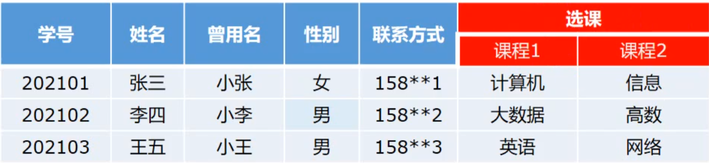
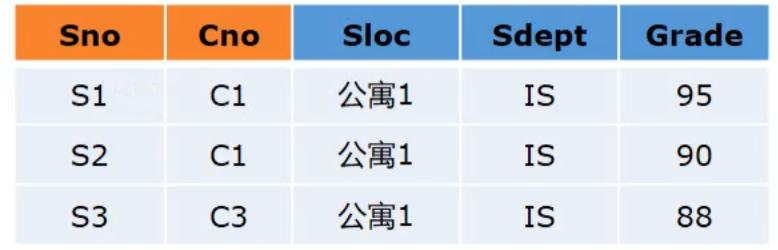

# 6. 关系数据理论

> **作用：** 设计出好的关系模式。

## 6.1 问题的提出

关系模式可以表示成：

$$
R(U, D, DOM, F)
$$

| 符号 | 大概意思 |
| --- | --- |
| `R` | 关系模式 |
| `U` | 属性的集合 |
| `D` | `U` 里面各属性所属的域 |
| `DOM` | 属性到域的映射 |
| `F` | `U` 上的一组数据依赖 |

不过这章先简化一下，只用：

$$
R(U, F)
$$

> **这章我们只看：** 属性集合，以及属性之间的数据依赖。

## 6.2 规范化

### 6.2.1 函数依赖

#### 基本定义

- **人话：**`X → Y` 就是左边的属性定了，右边的属性也就跟着定了。
- **例子：**`Sno → School`，学号定了，学校也就定了。

#### 几个术语

| 名称 | 怎么理解 |
| --- | --- |
| **非平凡函数依赖** | `X → Y`，但 `Y` 不是 `X` 的子集 |
| **平凡函数依赖** | `X → Y`，而且 `Y` 是 `X` 的子集 |

- `X` 叫**决定因素**。
- 如果 `X → Y` 和 `Y → X` 都成立，那 `X` 和 `Y` 就能互相确定。

#### 三种依赖

- **完全函数依赖：**`(Sno, Cno) → Grade`。`Grade` 得靠 `Sno` 和 `Cno` 一起确定，少一个都不行。
- **部分函数依赖：**`(Sno, Cno) → School`，但 `Sno → School`。其实 `School` 只看 `Sno`，不需要整个 `(Sno, Cno)`。
- **传递依赖：** 就是往下传；能从 `X → Y`、`Y → Z` 推到 `X → Z`，但不能反过来推。

### 6.2.2 码

#### 候选码、超码和主码

- 能把关系里所有属性都确定下来的属性（或属性组），就是找码时要看的东西。
- **候选码：** 能确定全部属性，而且已经不能再删属性了。
- **超码：** 也能确定全部属性，不过可能带了多余属性。
- 从候选码里挑一个出来，就是**主码**。

原笔记的记法：

- `K -F→ U`：`K` 是候选码。
- `K -P→ U`：`K` 是超码。

具体记号按老师上课的约定来。

#### 主属性和非主属性

- 候选码里出现过的属性，叫**主属性**。
- 哪个候选码里都没出现过的属性，叫**非主属性**。

#### 外码

例子：

- `SC(Sno, Cno, Grade)`
- `S(Sno, Sdept, Sage)`
- `SC` 里的 `Sno` 指向 `S` 里的 `Sno`，所以它是 `SC` 的外码。

### 6.2.3 范式

| 范式 | 先这么记 |
| --- | --- |
| **第一范式（1NF）** | 表里面不能套表，属性不能再拆 |
| **第二范式（2NF）** | 在 1NF 的基础上，非主属性得完整依赖候选码，不能只依赖候选码的一部分 |
| **第三范式（3NF）** | 简单记：别让非主属性绕一手、传递依赖候选码 |

#### 1NF 的缺陷

- **插入异常：** 没选课的学生，学生信息可能没法单独插进去。
- **删除异常：** 学生只选了一门课，删掉选课记录时，学生信息也跟着没了。
- **数据冗余：** 相同信息存了好几遍。
- **修改复杂：** 比如转系了，相关信息得改一片。

> 把 1NF 拆成几个 2NF，也不代表所有异常和冗余就都没了。

#### 第三范式（3NF）

复习时先记一句：**不能有非主属性对候选码的传递依赖。**

#### BC 范式（BCNF）（这块我还没搞懂）

这块原笔记写的是“没懂”。先留个定义方便之后回来补：每个非平凡函数依赖的决定因素都得是超码。

## 6.3 数据依赖的公理系统

### 6.3.1 逻辑蕴含

简单说：如果所有满足 `F` 的关系也都满足 `X → Y`，就说 `F` 能推出（逻辑蕴含）`X → Y`，记作：

$$
F \models X \to Y
$$

### Armstrong 公理系统

这三条先记住：

| 名称 | 规则 |
| --- | --- |
| **自反律** | `Y ⊆ X ⊆ U`，就有 `X → Y` |
| **增广律** | `X → Y`，两边同时加上 `Z`，就有 `XZ → YZ` |
| **传递律** | `X → Y`、`Y → Z`，就能推出 `X → Z` |

#### 自反律证明

#### 增广律证明

#### 传递律证明

### Armstrong 还能推出三条规则

#### 合并规则

`X → Y`，`X → Z`，就能合起来：

$$
X \to YZ
$$

证明思路：

- `X → Y`，用增广律得到 `X → XY`。
- `X → Z`，用增广律得到 `XY → YZ`。
- 把上面两步连起来，就有 `X → YZ`。

#### 伪传递规则

`X → Y`，`WY → Z`，就能推出：

$$
XW \to Z
$$

**怎么想：** 先把 `X → Y` 两边加上 `W`，得到 `XW → YW`；再接上 `WY → Z`，就得到 `XW → Z`。

#### 分解规则

`X → Y`，而 `Z` 是 `Y` 的一部分，那就有：

$$
X \to Z
$$

#### 引理 6.1

如果 `X` 能推出一组属性 `A₁A₂...Aₖ`，那就等价于它能分别推出里面每个属性：

$$
X \to A_1A_2\cdots A_k
\iff
X \to A_i \quad (1 \le i \le k)
$$

### 6.3.2 函数依赖集的闭包

- `F` 是题目给出来的那几条原始规则。
- `F⁺` 就是原始规则加上所有能用 Armstrong 推出来的规则，也就是那些“隐藏规则”。

### 6.3.3 属性集的闭包

`X_F⁺` 就是从 `X` 出发，顺着 `F` 能推出的所有属性：

$$
X_F^+ = \{A \mid F \models X \to A\}
$$

> **常考：** 给你 `F` 和 `X`，求 `$X^+_F$`。

#### 例题：求 `(AB)⁺`

#### 练习：求 `C⁺`

### 用函数依赖集 `F` 找候选码（会考）

看一个属性在函数依赖的左边、右边有没有出现，可以分成四类：

| 类别 | 怎么看 |
| --- | --- |
| **L 类** | 只在左边出现 |
| **R 类** | 只在右边出现 |
| **N 类** | 左右两边都没出现 |
| **LR 类** | 左右两边都出现 |

#### 先记这几个性质

- **L 类和 N 类**：一定要放进每一个候选码里。
- **R 类**：不用放进候选码。
- **LR 类**：要不要放，得算闭包再判断。
- 把 L 类和 N 类放一起算闭包；如果已经能推出 `U` 的全部属性，这一组就是唯一候选码。

### 定理 6.2：Armstrong 公理系统有效且完备

这句话的意思是：用这套公理推出来的东西没错，而且该推出来的函数依赖也都能推出来。

### 函数依赖集等价

如果两个函数依赖集 `F` 和 `G` 能推出的东西完全一样，也就是：

$$
F^+ = G^+
$$

那 `F` 和 `G` 就等价，也可以说它们互相覆盖。

### 极小函数依赖集（最小覆盖）

记作 `F_m`。要满足三件事：

1. 每条函数依赖的右边只能有一个属性。
2. 随便删掉一条，都会和原来的 `F` 不等价（所以不能再删）。
3. 左边也不能继续删属性；如果删掉左边某个属性还推得出来，那原来的左边就没化简到位。

> **人话：** 右边拆成单个属性；多余的规则删掉；每条规则的左边尽量简。

#### 例题：求最小覆盖

> 这里第 2、3 步可以调换。
